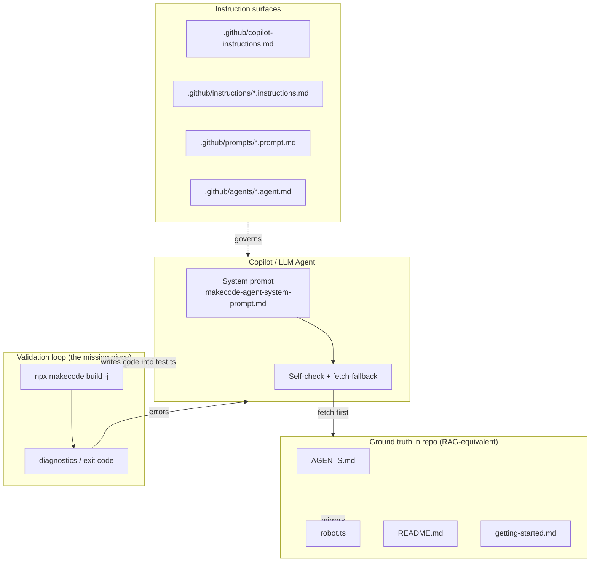
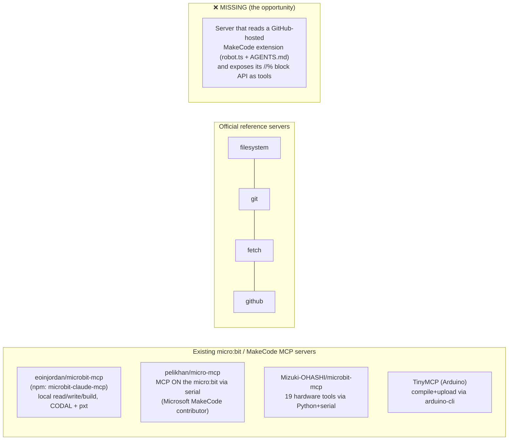
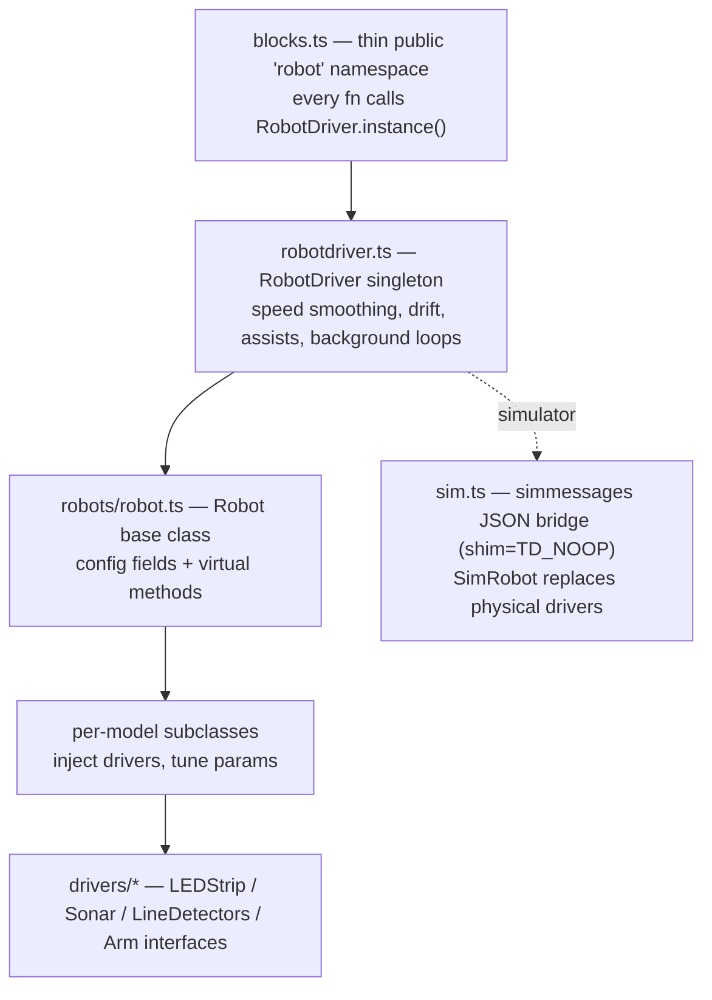

# Agentic Coding for MakeCode micro:bit — Research Report

**Topic:** Agentic coding for MakeCode micro:bit — use of agents, Copilot, and MCP — and what research in this area teaches us that we should bring into the `peterheldens/pxt-robotph` repo and/or the Copilot agent we are building for programming MakeCode micro:bit STEM projects and this robot.

**Date:** 2026-07-24 · **Query type:** Technical deep-dive + conceptual (hybrid) · **Subagent dispatches:** 7

---

## Executive Summary

There is now a mature, three-part foundation for agentic MakeCode development. **(1) Headless compilation is a solved problem**: the `makecode` (`mkc`) CLI and the `makecode-core` programmatic API let an agent type-check generated Static TypeScript in seconds without a browser — this is the single highest-value capability to add, because it converts an LLM's biggest weakness (API hallucination) into a hard pass/fail gate.[^1][^2] **(2) MCP prior art exists but has a specific gap**: at least four micro:bit/MakeCode MCP servers already exist (including one by a Microsoft MakeCode contributor that runs *on the micro:bit*), yet none reads a GitHub-hosted extension's `robot.ts`/`AGENTS.md` to expose its block API as agent tools — that is the open opportunity for `pxt-robotph`.[^3][^4][^5] **(3) The agent-readiness file ecosystem has standardized** around AGENTS.md + `.github/copilot-instructions.md` + path-scoped `.instructions.md` + `.prompt.md` + `.agent.md`, all of which are real, documented, and used in production repos.[^6][^7][^8] The `pxt-robotph` repo already implements the hard-to-get-right parts (authoritative API doc, fetch-first-with-fallback system prompt, self-check checklist); the remaining wins are additive, low-cost files plus a compile-validation loop.

Separately, education research is unambiguous about pedagogy: an AI STEM agent should **explain before it codes, encourage productive struggle, and disclose the simulator-vs-hardware gap** — three concrete adjustments to our current system prompt.[^9][^10][^11] Finally, the official `microsoft/microbit-robot` extension is an excellent architectural template (config-object robot class, injected peripheral drivers, `simmessages` JSON simulator bridge) that `pxt-robotph` could selectively adopt if it grows.[^12]

---

## Landscape Overview



The current repo covers the left and right boxes well; the **Validation loop** (center) and some **Instruction surfaces** (bottom) are the gaps.

---

## 1. MakeCode / PXT Tooling — the Agent Compile-Validation Loop

### 1.1 The correct headless build tool

MakeCode has a three-layer stack: the `pxt` CLI (for editor development — *not* for building extensions), the **`mkc`/`makecode` CLI** (npm package `makecode`, repo `microsoft/pxt-mkc`) which is the correct headless build tool, and the programmatic **`makecode-core`** library beneath it.[^1] `pxt-robotph` already uses `npx makecode` for its release builds, so the infrastructure is in place.

> ⚠️ Install `makecode`, **not** the unrelated npm package `mkc`.[^1]

Key CLI commands for an agent:[^1]

| Command | Purpose |
|---|---|
| `npx makecode build` | Compile native `.hex` (full ARM) |
| `npx makecode build -j` | **JavaScript mode — fast full type-check, no ARM** (best for a validation loop) |
| `npx makecode build -w` | Watch mode (live rebuild) |
| `npx makecode install` | Download dependencies to `pxt_modules/` |
| `npx makecode api-info` | Write `api-info.json` with every API symbol/block |
| `npx makecode build --update` | Force refresh of the cached editor (~50 MB, cached in `~/.makecode/`) |

Exit code is non-zero on compile failure; errors print as `file.ts(line,col): ERROR message` — directly usable as a CI/agent gate.[^1]

### 1.2 The recommended validation loop for THIS repo

`pxt.json` already lists `test.ts` in `testFiles`, which is compiled only when the extension is the top-level project.[^1] So the loop is:

1. Agent writes generated TypeScript into `test.ts`.
2. Run `npx makecode build -j` from the repo root.
3. Check exit code (0 = clean); parse diagnostics from stdout, or use the programmatic `CompileResult.diagnostics[]` for structured `{fileName, line, column, category, messageText}`.[^2]
4. Iterate until clean. This *also* verifies every `robot.*` call compiles against the real extension.[^1]

Programmatic alternative (for embedding in a tool/MCP server):[^2]

```typescript
import * as mkc from "makecode-core/built/mkc"
import { setHost } from "makecode-core/built/host"
import { createNodeHost } from "makecode-node/built/nodeHost"

setHost(createNodeHost())
const project = new mkc.Project("./")
await project.loadEditorAsync()
const result = await project.buildAsync({ javaScript: true })
if (!result.success)
  for (const d of result.diagnostics)
    if (d.category === 1 /* Error */)
      console.error(`${d.fileName}:${d.line}:${d.column} — ${d.messageText}`)
```

### 1.3 Static TypeScript (STS) constraints the agent MUST respect

STS is a TypeScript 2.6 subset.[^13] The agent should never generate:[^13]

- `var` (use `let`/`const`), `import`/`require`/`export default` (use `namespace`), `async`/`await` (use callbacks/events), generators/`yield`, `for...in` (`for...of` is OK), `eval`, `with`, function overloads, prototype patching, `arguments`/`apply`, JSX, or regex.
- **Nominal typing**: classes are not structurally interchangeable; an interface cannot extend a class.
- **Closure/scoping trap**: a `function` may only be called *after* all outer-scope `let`/`const` it references are defined, or compilation fails.[^13]
- Numbers are tagged 31-bit ints or boxed doubles (not full JS 64-bit).

These belong verbatim in the agent's system prompt (§2 already covers most; the closure trap and nominal typing are worth adding).

---

## 2. MCP Prior Art & a Blueprint for a MakeCode MCP Server

### 2.1 What already exists



Four working micro:bit/MakeCode MCP servers exist.[^3][^4][^5] The most complete, `eoinjordan/microbit-mcp` (npm `microbit-claude-mcp`), already exposes MakeCode project tools — `makecode_validate`, `makecode_read`, `makecode_write`, `makecode_build`, `makecode_init` — spawning the `pxt` CLI as a subprocess with a 180 s timeout.[^3] `pelikhan/micro-mcp` (by a Microsoft MakeCode contributor) runs a JSON-RPC 2.0 MCP server *on the micro:bit itself*, bridged over USB serial, and ships as an installable MakeCode extension.[^4] The official `modelcontextprotocol/servers` repo provides reusable filesystem, git, and fetch servers.[^14]

### 2.2 The gap and a concrete tool surface

**No existing server reads a GitHub-hosted MakeCode extension repo to understand its block API, nor parses `//% block=` annotations into a callable vocabulary.**[^3][^4][^5] A purpose-built (or fork-extended) MCP server for `pxt-robotph` should expose:[^3][^14]

| Tool | Inspiration | Purpose |
|---|---|---|
| `read_extension_api` | NEW | Fetch `robot.ts` from GitHub + parse exported blocks/enums |
| `read_agents_guide` | NEW | Read `AGENTS.md` behavioral rules |
| `list_blocks` | NEW | Parse `//% block=` annotations → block vocabulary |
| `get_pxt_json` / `read_source_files` | `eoinjordan/microbit-mcp` | Project metadata + all `.ts` |
| `write_main_ts` / `validate_project` / `build_project` | `eoinjordan/microbit-mcp` | Write, validate, run `mkc build` |
| `fetch_makecode_docs` | `modelcontextprotocol/servers` (fetch) | Pull docs from makecode.microbit.org/reference |
| `git_commit_result` | `modelcontextprotocol/servers` (git) | Commit generated code to a feature branch |

Recommended stack: the TypeScript `@modelcontextprotocol/sdk` with `StdioServerTransport`, reusing `eoinjordan/microbit-mcp`'s `makecode.ts` build scaffold.[^3]

---

## 3. Agent-Readiness Conventions & File Formats (all verified in production repos)

### 3.1 The standardized instruction stack

The ecosystem converged in 2025 on a layered system, with a documented precedence (merged, not exclusive):[^6][^7]

```
1. Personal instructions (user profile)              ← highest
2. .github/instructions/*.instructions.md (path-scoped, applyTo)
3. .github/copilot-instructions.md (repo-wide)
4. AGENTS.md / CLAUDE.md / GEMINI.md (agent instructions)
5. Organization-wide instructions                    ← lowest
```

AGENTS.md was formalized at [agents.md](https://agents.md) and is honored by GitHub Copilot, VS Code, Claude Code, Codex, Gemini CLI, Cursor, Aider, and others.[^6] For PRs, Copilot reads instructions from the **head branch**, so instruction changes can be tested in the same PR.[^7]

### 3.2 Copy-pasteable, real-world-verified templates

**Path-specific instructions** (`.github/instructions/*.instructions.md`) — `applyTo` is required:[^8]

```yaml
---
description: 'Rules for the robot extension source'
applyTo: 'robot.ts, _locales/**'
---
# Robot extension review rules
- Every new block needs a //% block= annotation.
- Pin numbers must match the AGENTS.md pin map.
- Enum value changes require a major version bump.
- Block-text changes require updates to ALL five _locales folders.
```

**Prompt files** (`.github/prompts/*.prompt.md`) — reusable `/slash-commands`:[^8]

```yaml
---
name: new-tutorial
description: 'Scaffold a MakeCode micro:bit robot tutorial'
mode: agent          # VS Code key; awesome-copilot uses "agent:"
model: claude-sonnet-4-5
tools: ['codebase', 'fetch']
argument-hint: "Describe the tutorial goal, e.g. 'clap makes the robot happy'"
---
Create a MakeCode tutorial for the microbitrobot. Read AGENTS.md first;
follow makecode-agent-system-prompt.md §4. Output: tutorial markdown + #tutorial: URL.
```

**Custom agent** (`.github/agents/*.agent.md`) — verified distinct from `.chatmode.md`:[^8]

```yaml
---
name: "MakeCode Master"
description: 'Expert MakeCode micro:bit programmer for the microbitrobot; use for robot code + tutorials'
model: claude-sonnet-4-5
tools: [read, edit, search, execute, web]
---
[system-prompt body — can reference/reuse makecode-agent-system-prompt.md]
```

> **`.agent.md` vs `.chatmode.md`:** `.agent.md` (in `.github/agents/`, has a `name:` key, ~12.6k repos) is the Copilot Coding Agent persona format catalogued by `github/awesome-copilot`; `.chatmode.md` (in `.github/chatmodes/`, no `name:` key — filename is the mode, ~2.8k repos) is the VS Code chat-panel mode.[^8] `microsoft/vscode-jupyter` uses both simultaneously and is the best full-layout reference.[^8]

### 3.3 Field-requirement rules (from `github/awesome-copilot`)

- **prompt.md:** `description` required; `agent`/`mode` required; `name`, `model` strongly encouraged; `tools` encouraged.[^8]
- **instructions.md:** `description` + `applyTo` required (single string or comma-separated globs, or a YAML array).[^8]
- **agent.md:** `description` required; `name`, `model` strongly encouraged; `tools` encouraged. Lowercase, hyphenated filenames.[^8]

### 3.4 Pitfalls

Keep instruction files under ~500 lines / ~1.5–2k tokens; >1,000 lines causes inconsistent behavior.[^7] Duplicated facts across `AGENTS.md`, `copilot-instructions.md`, and the system prompt drift out of sync — the biggest real risk here. Custom instructions do **not** affect inline autocomplete (Chat/agent modes only).[^7] Mitigation: a **"Sync contract"** section naming which files must change together, plus a `<!-- last verified: date, pxt.json vX.Y.Z -->` stamp on AGENTS.md.[^6][^7]

---

## 4. AI-for-MakeCode & STEM Pedagogy — Lessons to Encode

### 4.1 What officially exists (and doesn't)

Microsoft has shipped two production AI features in MakeCode micro:bit — the **Error Helper** (explains exceptions) and the **Code Evaluation Tool** (teachers ask NL questions about student code, GA July 2025) — both are *explanation/evaluation*, not code generation.[^15][^16] The micro:bit Foundation's **CreateAI** enables on-device gesture-ML with auto-generated blocks (`microbit-foundation/pxt-microbit-ml`, V2 required).[^17] **No official natural-language→blocks generator exists.**[^15] Community practice (ChatGPT for micro:bit) works well for TypeScript/JavaScript, and MakeCode's **JS↔blocks toggle is the de-facto verification layer** — LLM-generated TypeScript pasted in can be instantly checked as blocks.[^18]

### 4.2 Documented LLM failure modes for embedded/MakeCode code

| Hallucination type | MakeCode example |
|---|---|
| Invented function | `microbit.displayText()` instead of `basic.showString()` |
| Cross-platform mixing | Arduino `Serial.print()` in micro:bit code |
| Wrong pin | NeoPixels on P10 instead of P8 |
| Non-existent robot block | `robot.moveTo(x,y)` (not in `robot.ts`) |
| Version mismatch | V2-only `input.onSound()` without flagging V2 |
| Blocking in handler | `while(true)` inside `onButtonPressed` |

Package-hallucination rates run 5–20% across models.[^19] **Proven mitigations**: ground the model with the complete API before generating (RAG / in-context), explicit "never invent" rules, **post-generation compilation check**, and chain-of-verification self-critique.[^19][^20] The repo already does the first, second, and fourth; the **compilation check (§1.2) is the missing mitigation.**

### 4.3 Pedagogy research → concrete prompt changes

Research frames the AI as a **metacognitive co-regulator, not an answer machine**, and confirms **worked examples** ("I do / we do / you do") as the best novice on-ramp, while warning of over-reliance / "learned helplessness" in K-12.[^9][^10][^11] Actionable changes to `makecode-agent-system-prompt.md`:

- **Gap 1 — Explain before code.** Reorder §6 so the plain-language walkthrough comes *before/interleaved with* code, not after.[^10]
- **Gap 2 — Productive struggle.** For simple child requests ("make the eyes blue"), first say which block to drag and invite them to try; give full code only if asked again or stuck. Add a self-check item: "Did I encourage the child to try first?"[^9][^11]
- **Gap 3 — Simulator-vs-hardware disclosure.** After any servo/NeoPixel/clap program, add: "Test in the simulator first (P8 NeoPixels show there), then download to your micro:bit V2 to test the microphone and servos."[^12][^21]
- **Gap 4 — Sensible defaults over questions.** For children, pick a fun default and say what/why, rather than asking first.[^9]
- **Gap 5 — Bluetooth memory trap.** Note that Bluetooth on V1 consumes ~14 KB of 16 KB RAM; always prefer radio for multi-micro:bit projects.[^18]
- **Gap 6 — CreateAI awareness.** Mention on-device gesture ML (createai.microbit.org, V2) as an advanced option for gesture-driven robot poses.[^17]

---

## 5. MakeCode Tutorial Authoring (for step-by-step output)

The tutorial format is a Markdown dialect: `#` = title, each `##` = a step, fenced code blocks with special tags control rendering, and `### @KEY value` directives set global metadata.[^22]

- **Step modifiers:** `## Title @showdialog` (overlay dialog; replaces deprecated `@unplugged`), `@showhint`.[^22]
- **Global directives (before first step):** `### @explicitHints true`, `### @diffs true`, `### @hideIteration true`.[^22]
- **Code fences:** ` ```blocks ` (renders blocks, restricts toolbox to those blocks), ` ```typescript `, ` ```template ` (starter code, placed at file bottom), ` ```ghost ` (adds toolbox blocks without showing them), ` ```package ` (declares extension deps), ` ```validation.global ` with `# BlocksExistValidator`.[^22]
- **Inline block refs:** `` ``||basic:show string||`` `` — the namespace before `:` sets the color and opens that toolbox category; `||basic(noclick):on start||` suppresses the click.[^22]
- **Macros:** `@boardname@` → "micro:bit", `@drivename@` → "MICROBIT". Instruction icons like `:mouse pointer:`, `:lightbulb:`.[^22]
- **Loading:** `https://makecode.microbit.org/#tutorial:https://github.com/peterheldens/pxt-robotph/<file>` — any `.ts` in the repo is auto-added as extension code.[^22] `#example:` and `#recipe:` variants exist.
- **Docs snippets (for reference pages):** ` ```sig `, ` ```cards `, ` ```namespaces `, ` ```apis `.[^22]

**Canonical example projects** an agent should know (each maps to a teaching goal): Flashing Heart (`showLeds`/`forever`), Name Tag (`showString`), Smiley Buttons (`onButtonPressed`/`showIcon`), Dice (`onGesture(Shake)`/`randint`), Love Meter (`onPinPressed`/`TouchPin`), Micro Chat (radio), and V2 set — Pet Hamster (`onLogoEvent`), Clap Lights (`onSound`), Blow Away, Cat Napping (data logging).[^22] Idiomatic API patterns (event handlers, `on start` vs `forever` with a mandatory `basic.pause` to yield, radio, `pins.servoWritePin`, music V2) are documented for direct reuse.[^22]

---

## 6. `microsoft/microbit-robot` — an Architectural Template

The official multi-robot extension supports 13+ commercial robots behind **one unified API** via a clean three-layer design, and is a strong model if `pxt-robotph` grows (e.g., robot variants, an animated simulator).[^12]



Patterns worth selectively adopting:[^12]

| Pattern | How it maps to `pxt-robotph` |
|---|---|
| `Robot` base class with config fields | A `RobotPH` config object: `ledPin`, `ledCount`, `servoMinAngle`, `servoMaxAngle` |
| Interface-injected peripherals | `NeoPixelFace` / `Servo` interfaces; swap for `SimFace`/`SimServo` in simulator |
| `fixedInstance` + `.instance()` singleton | Prevents "robot not started" errors; one `start()` block, unified rest |
| `simmessages` JSON bridge (`shim=TD_NOOP`) | A future animated face/servo web simulator alongside the current `pxtparts.json` |
| Flash-persisted calibration (`storage.cpp`) | Persist servo trim + LED brightness across power cycles |
| `//% groups` block organization | Already used in `pxt-robotph` (Setup/Colors/Expressions/Arms/Radio) ✓ |

Two caveats: `microbit-robot` uses a **separate hosted web simulator** (not `pxtparts.json`), which is more powerful but heavier;[^12] and it has **no AGENTS.md / copilot-instructions** — so on agent-readiness, `pxt-robotph` is *ahead* of the official repo.[^12]

---

## Key Repositories Summary

| Repo | Relevance |
|---|---|
| [microsoft/pxt-mkc](https://github.com/microsoft/pxt-mkc) | The `makecode`/`mkc` headless build CLI + `makecode-core` API — the validation loop[^1][^2] |
| [microsoft/pxt](https://github.com/microsoft/pxt) · [pxt-microbit](https://github.com/microsoft/pxt-microbit) | STS compiler, `pxt.json` schema, tutorial/doc formats[^13][^22] |
| [eoinjordan/microbit-mcp](https://github.com/eoinjordan/microbit-mcp) | Richest MakeCode MCP server (validate/read/write/build) — reuse its build scaffold[^3] |
| [pelikhan/micro-mcp](https://github.com/pelikhan/micro-mcp) | MCP on-device via serial, by a Microsoft MakeCode contributor[^4] |
| [Mizuki-OHASHI/microbit-mcp](https://github.com/Mizuki-OHASHI/microbit-mcp) | 19 hardware-control MCP tools (Python + serial)[^5] |
| [modelcontextprotocol/servers](https://github.com/modelcontextprotocol/servers) | Reusable filesystem/git/fetch reference servers[^14] |
| [github/awesome-copilot](https://github.com/github/awesome-copilot) | Canonical catalog + field-requirement rules for instructions/prompts/agents[^8] |
| [microsoft/vscode-jupyter](https://github.com/microsoft/vscode-jupyter) | Best full agent-ready layout (chatmodes + prompts + instructions)[^8] |
| [microsoft/microbit-robot](https://github.com/microsoft/microbit-robot) | Architectural template: config-object robots, driver interfaces, sim bridge[^12] |
| [microbit-foundation/pxt-microbit-ml](https://github.com/microbit-foundation/pxt-microbit-ml) | CreateAI gesture-ML extension (V2)[^17] |

---

## Prioritized Recommendations for `pxt-robotph`

**Tier 1 — highest ROI (do first)**
1. **Add a compile-validation loop.** Wire `npx makecode build -j` (writing candidate code into `test.ts`) into the agent workflow / a `/validate` prompt file. This is the single biggest anti-hallucination win and is already half-built in this repo.[^1][^19]
2. **Encode STS hard-constraints + closure/nominal-typing traps** into the system prompt §2.[^13]
3. **Apply the four pedagogy edits** (explain-before-code, productive struggle, simulator-vs-hardware disclosure, sensible defaults) to `makecode-agent-system-prompt.md`.[^9][^10][^11][^12]

**Tier 2 — low-cost agent-readiness files**
4. Add `.github/instructions/robot-extension.instructions.md` (applyTo `robot.ts, _locales/**`) and a `docs.instructions.md`.[^8]
5. Add `.github/prompts/new-tutorial.prompt.md` and `add-block.prompt.md`.[^8]
6. Optionally add `.github/agents/makecode-master.agent.md` (reuse the system-prompt body) and a redirect `CLAUDE.md`.[^6][^8]
7. Add a **"Sync contract"** section + `<!-- last verified -->` stamp to `AGENTS.md` to prevent cross-file drift.[^7]

**Tier 3 — bigger bets (only if the project grows)**
8. Build/fork an **MCP server** exposing `read_extension_api` + `list_blocks` + `build_project` for `pxt-robotph`, reusing `eoinjordan/microbit-mcp`'s scaffold — this closes the documented ecosystem gap.[^3]
9. Adopt `microbit-robot`'s **config-object + injected-driver + `simmessages`** patterns if adding robot variants or an animated simulator.[^12]

---

## Confidence Assessment

**High confidence (directly verified in source/docs):**
- MakeCode `mkc`/`makecode-core` CLI commands, build flags, `-j` type-check mode, `CompileResult` shape, and STS constraints — verified in `microsoft/pxt-mkc` source and makecode.com/language.[^1][^2][^13]
- Existence and tool surfaces of the four micro:bit/MakeCode MCP servers and the reference servers — verified from their source files.[^3][^4][^5][^14]
- The instruction-file formats, precedence, and field requirements — verified against GitHub/VS Code docs and real production repos with commit SHAs.[^6][^7][^8]
- Tutorial markdown syntax and canonical projects — verified in `microsoft/pxt-microbit` docs.[^22]
- `microsoft/microbit-robot` architecture — verified across its source files.[^12]

**Medium confidence (inferred / synthesized):**
- The proposed MCP tool surface for `pxt-robotph` is a synthesis of prior art, not an existing product; effort estimate is inferential.[^3]
- Pedagogy recommendations are research-backed in general STEM/CS-ed contexts and mapped by analogy to this specific robot agent.[^9][^10][^11]

**Assumptions made:**
- "This repo" = `peterheldens/pxt-robotph` and "the Copilot agent we make" = the agent governed by `makecode-agent-system-prompt.md`.
- The audience is children/teachers (STEM classroom), consistent with the repo's framing.
- `.cpp` shims (e.g., `microbit-robot`'s `storage.cpp`) were not fetched (native/binary); the flash-calibration recommendation assumes an equivalent shim would be needed.[^12]

**Not investigated / open items:**
- The `microbit-robot` web-simulator source (separate repo/branch).[^12]
- Whether any newer official MakeCode "NL→blocks" feature shipped after the reviewed 2025 blog posts.[^15]

---

## Footnotes

[^1]: `microsoft/pxt-mkc` — CLI commands & build flags: `packages/makecode-node/src/cli.ts`, `packages/makecode-core/src/commands.ts`, `packages/makecode-core/src/loader.ts:26-46` (microbit target auto-detect). Docs: https://github.com/microsoft/pxt-mkc
[^2]: `microsoft/pxt-mkc` — programmatic API: `packages/makecode-core/src/service.ts:1-230` (`CompileResult`, `KsDiagnostic`, `Ctx`), `packages/makecode-core/src/mkc.ts:57-230` (`Project`), `packages/makecode-core/src/host.ts:17-55` (`LanguageService`).
[^3]: `eoinjordan/microbit-mcp` (npm `microbit-claude-mcp`): `src/mcp.ts:108-205` (MakeCode tools), `src/makecode.ts:64-92` (`pxt build` spawn), `package.json`. https://github.com/eoinjordan/microbit-mcp
[^4]: `pelikhan/micro-mcp`: `mcp.ts:1-290` (on-device JSON-RPC MCP server), `bridge.mjs:6-21` (USB auto-detect), `pxt.json`, `package.json`. https://github.com/pelikhan/micro-mcp
[^5]: `Mizuki-OHASHI/microbit-mcp`: `src/main.ts:170-190` (command dispatch, 19 tools). https://github.com/Mizuki-OHASHI/microbit-mcp
[^6]: AGENTS.md spec & tool support: https://agents.md · https://github.com/agentsmd/agents.md · GitHub docs: https://docs.github.com/en/copilot/how-tos/copilot-on-github/customize-copilot/add-custom-instructions/add-repository-instructions
[^7]: Copilot instruction precedence, head-branch behavior, pitfalls: https://docs.github.com/en/copilot/concepts/prompting/response-customization · https://github.blog/ai-and-ml/github-copilot/unlocking-the-full-power-of-copilot-code-review-master-your-instructions-files/
[^8]: Verified real file formats & field rules: `github/awesome-copilot:.github/copilot-instructions.md` (SHA 0645f284); prompt `microsoft/vscode-jupyter:.github/prompts/plan.prompt.md` (SHA 6587e5b4); instructions `primer/react:.github/instructions/css.instructions.md` (SHA 67f2ffdc), `dotnet/fsharp:.github/instructions/LSP.instructions.md` (SHA 8b7a3b29); agent `tfutils/tfenv:.github/agents/pm.agent.md` (SHA 51cc7161), `github/awesome-copilot:agents/CSharpExpert.agent.md` (SHA 170d8f34); chatmode `microsoft/vscode-jupyter:.github/chatmodes/bugfix.chatmode.md` (SHA 4c3fae6e). https://github.com/github/awesome-copilot
[^9]: AI as metacognitive co-regulator / scaffolding: *Journal of Intelligence* 2025, 13(11):148 — https://www.mdpi.com/2079-3200/13/11/148 · *Computers & Education* 2025 — https://www.sciencedirect.com/science/article/pii/S0360131525002416
[^10]: Worked examples ("I do/we do/you do"): MIT TLL — https://tll.mit.edu/teaching-resources/how-people-learn/worked-examples/ · EEF — https://educationendowmentfoundation.org.uk/news/eef-blog-working-with-worked-examples-simple-techniques-to-enhance-their-effectiveness
[^11]: Over-reliance / novices with LLM code generators: CHI 2023 — https://dl.acm.org/doi/fullHtml/10.1145/3544548.3580919 · https://arxiv.org/pdf/2309.14049 · Stanford K-12 AI evidence 2026 — https://scale.stanford.edu/sites/default/files/The%20Evidence%20Base%20on%20AI%20in%20K-12%20Report.pdf
[^12]: `microsoft/microbit-robot` architecture: `blocks.ts`, `robotdriver.ts`, `robots/robot.ts`, `drivers/drivers.ts`, `sim.ts`, `robots/sim.ts`, `calibration.ts`, `constants.ts`, `pxt.json`; no AGENTS.md/copilot-instructions (404). https://github.com/microsoft/microbit-robot
[^13]: Static TypeScript supported/unsupported features & closure trap: https://makecode.com/language · block annotations: https://makecode.com/defining-blocks
[^14]: `modelcontextprotocol/servers`: `src/filesystem/README.md`, `src/git/README.md`, `src/fetch`. https://github.com/modelcontextprotocol/servers
[^15]: Official MakeCode AI (no NL→blocks generation): https://makecode.com/blog · Error Helper FAQ https://makecode.microbit.org/errorhelper/ai-faq · Code Eval FAQ https://makecode.microbit.org/teachertool/ai-faq
[^16]: Code Evaluation Tool (Beta Jan 2025 → GA Jul 2025): https://makecode.com/blog/tools/code-eval-tool · https://makecode.com/blog/microbit/2025-update
[^17]: micro:bit CreateAI (on-device gesture ML, V2): https://microbit.org/get-started/user-guide/microbit-createai/ · https://createai.microbit.org/ · https://github.com/microbit-foundation/pxt-microbit-ml
[^18]: Community ChatGPT+micro:bit, JS↔blocks verification, Bluetooth RAM trap: https://littlebirdelectronics.com.au/projects/using-chatgpt-to-help-with-micro-bit-coding · https://cardboard.lofirobot.com/coding-microbit-with-ai-chatbot/
[^19]: LLM code/package hallucination rates & taxonomy: USENIX Security 2025 — https://www.usenix.org/system/files/usenixsecurity25-spracklen.pdf · https://arxiv.org/abs/2511.00776 · https://arxiv.org/abs/2501.19012
[^20]: RAG grounding reduces hallucination: https://cloud.google.com/blog/products/ai-machine-learning/context-aware-code-generation-rag-and-vertex-ai-codey-apis
[^21]: Simulator-vs-hardware gap: `microsoft/microbit-robot:README.md` (simulator caveat); `peterheldens/pxt-robotph:AGENTS.md §7 point 8` (NeoPixel P10–P16 simulator bug); https://forum.makecode.com/t/different-behavior-between-simulator-and-micro-bit/14641
[^22]: MakeCode tutorial & docs authoring: https://makecode.com/writing-docs/tutorials/basics · https://makecode.com/writing-docs/tutorials/control-options · https://makecode.com/writing-docs/snippets · https://makecode.com/writing-docs/user-tutorials · examples in `microsoft/pxt-microbit:docs/projects/` (flashing-heart.md, dice.md, micro-chat.md, v2-clap-lights.md) and `docs/reference/`.
